# CompilaAí

**Rede social dos alunos de Desenvolvimento de Sistemas.** Cada pessoa publica um post curto sobre o que
está construindo ou aprendendo — um app novo, uma dúvida de lógica, uma prova vencida — e os colegas
descobrem, curtem e comentam.

Projeto prático de **Desenvolvimento de Aplicativos Mobile II (PAM II)** — ETEC Prof. Edson Galvão.
Professor: Hugo Alessi Rolim Moreira da Silva. Autoria: João Vitor Menk Alves.
Enunciado: [`docs/PAM_II_Atividade_Rede_Social.pdf`](docs/PAM_II_Atividade_Rede_Social.pdf).

| Camada | Tecnologia |
|---|---|
| App | React Native + **Expo SDK 58** + Expo Router + TypeScript |
| Nuvem | **Supabase Free** (Auth por e-mail/senha + PostgreSQL + RLS) |
| Aparelho | **SQLite** (`expo-sqlite`): rascunho e último feed · **AsyncStorage**: sessão (via SDK do Supabase) |
| Visual | Componentes próprios com `StyleSheet` (sem UI kit) · fontes **Space Grotesk** (títulos) e **DM Sans** (texto) via `@expo-google-fonts` · ícones Ionicons |

## Telas

**No computador** o app se adapta: conteúdo com largura de leitura, busca no topo, coluna da comunidade
à direita e a barra de abas vira uma pílula centralizada. O menu lateral abre pelo ☰ e fecha tocando fora,
igual ao celular.

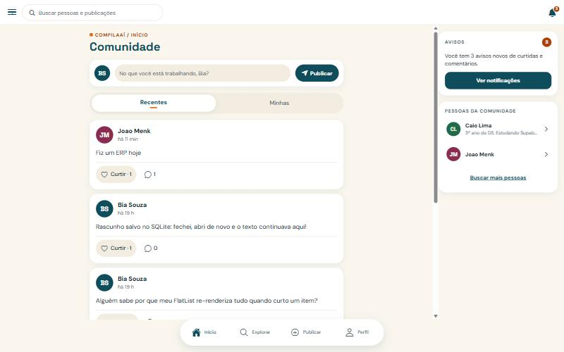

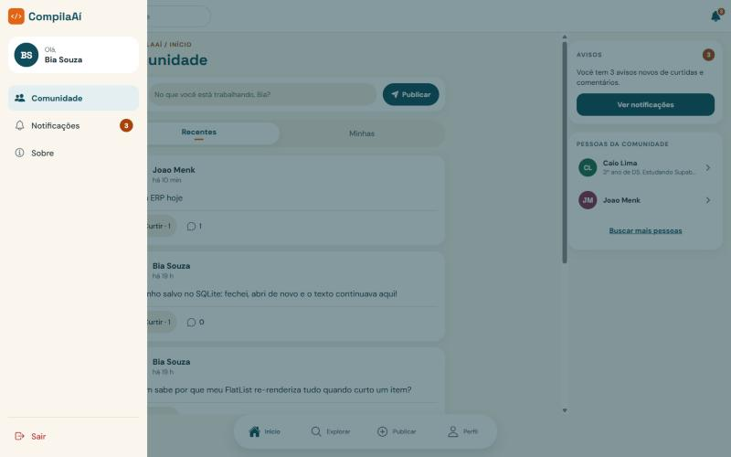

**No celular:**

| Entrar | Criar conta | Início | Explorar | Publicar |
|:---:|:---:|:---:|:---:|:---:|
| 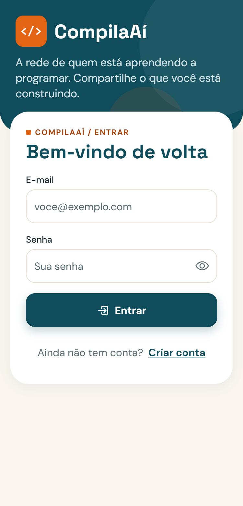 | 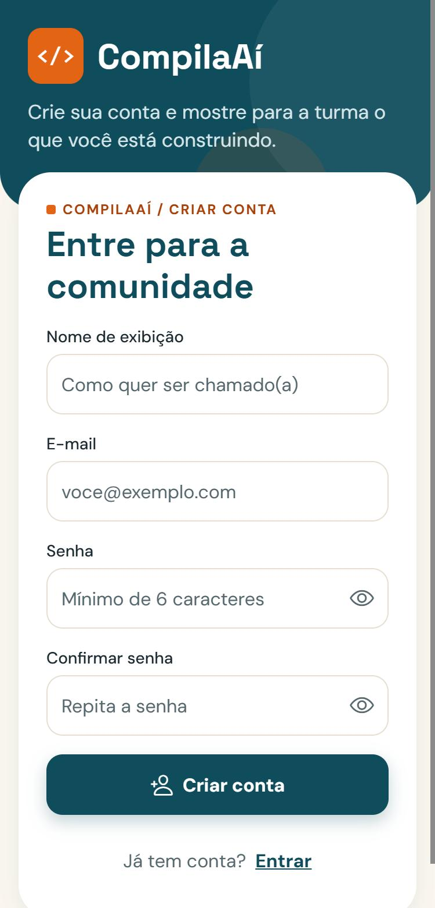 | 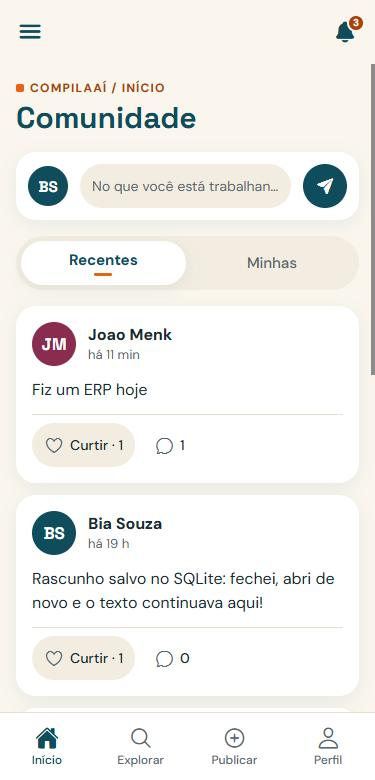 | 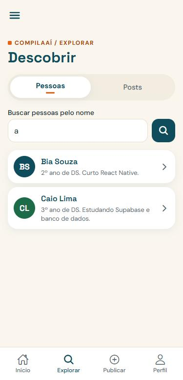 | 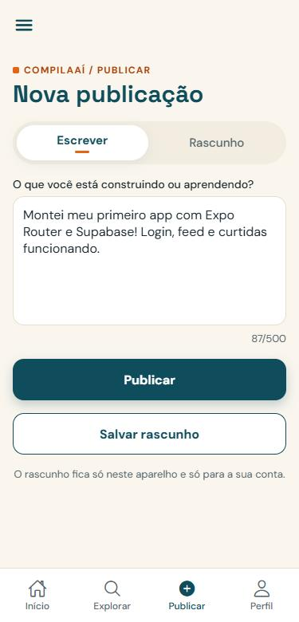 |

| Perfil | Publicação | Notificações | Menu lateral | Sobre |
|:---:|:---:|:---:|:---:|:---:|
| 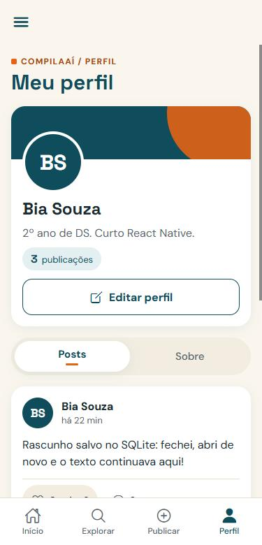 | 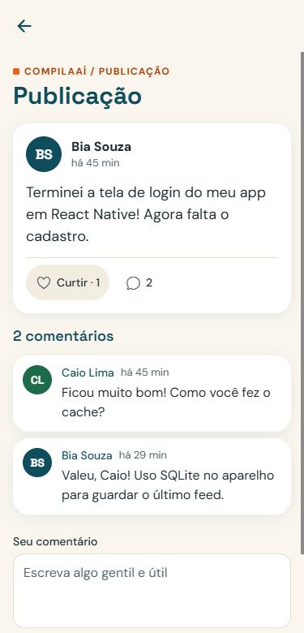 | 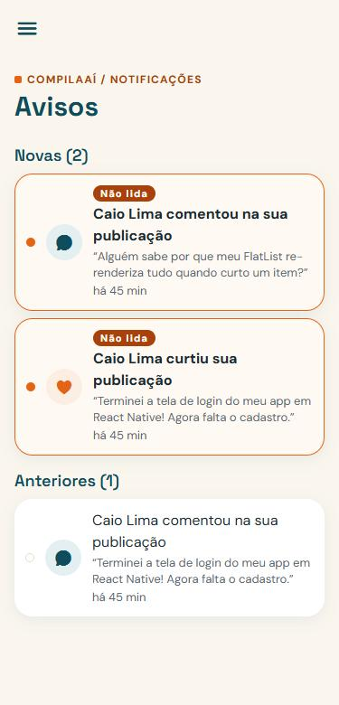 | 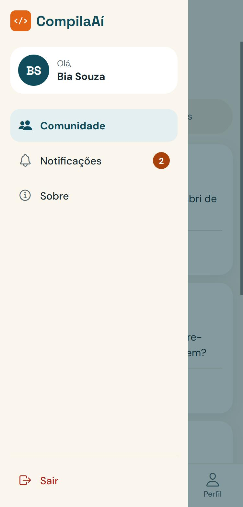 | 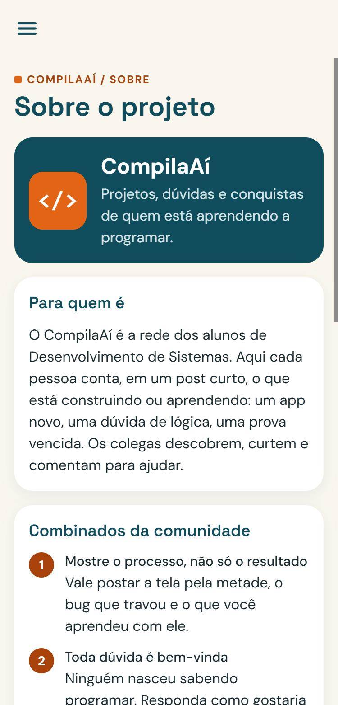 |

> Capturas da versão web em tamanho de celular (375 px), com as contas de demonstração.

---

## Pré-requisitos

- **Node.js 24 LTS** (usado no desenvolvimento: v24.16.0) e npm.
- Celular com **Expo Go** compatível com o SDK 58, ou um **emulador Android** (Android Studio).
- Uma conta gratuita no [Supabase](https://supabase.com).

## Instalação

```bash
git clone https://github.com/joaomenkdev-cloud/compilai.git
cd compilai
npm install
```

## Configurar o Supabase (uma vez)

1. Crie um projeto **Free** no Supabase.
2. Abra **SQL Editor**, cole todo o conteúdo de [`supabase/schema.sql`](supabase/schema.sql) e clique em **Run**.
   O script é idempotente (pode rodar de novo sem quebrar). Ele cria, nesta ordem: `profiles` → `posts` →
   `likes` → `comments` → `notifications` → função `avisar_autor()` + gatilhos, com **RLS ligado em todas as tabelas**.
   Como o script recria políticas (`drop policy if exists`), o painel pede uma confirmação: confirme.
3. Em **Authentication → Sign In / Providers**, desligue **Confirm email** para facilitar os testes
   (o app também funciona com ele ligado: explica que é preciso confirmar o e-mail antes de entrar).
4. Em **Connect** (ou Settings → API Keys), copie a **Project URL** e a **chave publicável** (`sb_publishable_…`).
5. Copie `.env.example` para `.env` e preencha:

```env
EXPO_PUBLIC_SUPABASE_URL=https://SEU-PROJETO.supabase.co
EXPO_PUBLIC_SUPABASE_PUBLISHABLE_KEY=sb_publishable_...
```

> Só a URL e a chave **publicável** vão no app. A chave secreta/`service_role` e a senha do banco **nunca**
> entram no código. O `.env` está no `.gitignore`.

> ⚠️ **O plano Free pausa o projeto após 1 semana sem uso.** Antes da apresentação, abra o painel do
> Supabase e confira se o projeto está ativo (se estiver pausado, clique em *Restore*).

## Rodar

```bash
npx expo start
```

- **Celular:** abra o Expo Go e leia o QR code.
- **Emulador Android:** com o emulador aberto, aperte `a` no terminal.
- **Navegador:** aperte `w` (útil para mostrar as telas; o `metro.config.js` habilita o SQLite na web).
  Extensões como Dark Reader mudam as cores da página.

Contas de demonstração e roteiro: [`supabase/seed.md`](supabase/seed.md) e [`docs/TESTES.md`](docs/TESTES.md).

### Build de prévia (splash nativa e modo offline)

O Expo Go baixa o código pela rede e mostra a própria splash. Para ver a **splash nativa** do CompilaAí e
testar o app **sem internet**, gere um APK instalável:

```bash
npm install -g eas-cli
eas login
eas build --profile preview --platform android
```

No fim, o EAS mostra um link/QR para baixar e instalar o APK. (O perfil `preview` está em `eas.json`.)
Na primeira vez, o `eas build` pergunta se deve criar o projeto no EAS: responda que sim.
Se o `.env` não for enviado ao EAS, cadastre as duas variáveis `EXPO_PUBLIC_…` em
**expo.dev → projeto → Environment variables** antes do build.

---

## O que fica no aparelho × o que vai para a nuvem

| Dado | Onde | Por quê |
|---|---|---|
| Perfis, posts, curtidas, comentários, avisos | **Nuvem** (Supabase/PostgreSQL) | precisam ser vistos por outras contas, em outros aparelhos |
| Sessão (token de acesso) | **Aparelho** (AsyncStorage, gerenciado pelo SDK) | manter a pessoa logada ao reabrir; o SDK renova o token |
| Rascunho de publicação | **Aparelho** (SQLite, tabela `drafts`) | é pessoal e ainda não foi publicado |
| Último feed lido | **Aparelho** (SQLite, tabela `feed_cache`) | permite ler o feed sem internet |
| Senha | **Nenhum lugar do app** | só o Supabase Auth a conhece |

Tudo no SQLite é separado pelo **ID do usuário da sessão** (`dono`): com duas contas no mesmo aparelho,
B nunca vê o rascunho nem o feed salvo de A.

**Exemplo — o rascunho:** ao tocar em *Salvar rascunho*, o texto vai para `drafts` (SQLite) com `dono = id da
conta`; nada é enviado à nuvem. Ele só sai do aparelho quando a pessoa toca em *Publicar* — e só é apagado
depois que o Supabase confirma a publicação. Se a internet cair na hora de publicar, o texto é guardado como
rascunho para envio **manual** depois (não há fila automática).

### Função chamada em caso de falha de rede

**`buscarFeed(usuarioId)`** em [`src/services/postService.ts`](src/services/postService.ts):

1. busca o feed no Supabase e, se der certo, salva uma cópia com `salvarFeed(dono, posts)`;
2. se a busca falhar **por falta de rede**, chama **`lerFeed(dono)`** ([`src/storage/feedCache.ts`](src/storage/feedCache.ts))
   e devolve a última cópia — a tela mostra *"Sem conexão · última atualização às HH:MM"*;
3. se não houver cópia (primeiro uso sem internet), a tela informa que *o primeiro carregamento precisa de internet*.

---

## Teste 4 · Autorização (script)

Mostra que, logado como B com a chave publicável, **não** é possível alterar o perfil de A.

1. Copie `.env.teste.example` para `.env.teste` e preencha `TESTE_B_EMAIL`, `TESTE_B_SENHA` (conta B) e `TESTE_A_NOME`.
2. Rode:

```bash
npm run teste:autorizacao
```

Saída esperada: `Linhas alteradas pela tentativa de B: 0` e `RESULTADO: PASSOU ✅`.
(O script está em [`scripts/teste-autorizacao.ts`](scripts/teste-autorizacao.ts); o Node 22.18+ roda TypeScript direto.)

---

## Organização do código

```
src/
  app/                       rotas (Expo Router)
    _layout.tsx              Stack raiz + AuthProvider + splash; Stack.Protected separa público × privado
    login.tsx  cadastro.tsx  telas públicas
    (rede)/_layout.tsx       Drawer (menu lateral) da área logada
    (rede)/(tabs)/           Início · Explorar · Publicar · Perfil (barra inferior)
    (rede)/notificacoes.tsx  sobre.tsx  editar-perfil.tsx  post/[id].tsx  pessoa/[id].tsx
  components/                PostCard, CampoTexto, Botao, AbasInternas, Avatar, estados (vazio/erro/offline)…
  contexts/                  AuthProvider (sessão e perfil) · AvisosProvider (contador de não lidas)
  services/                  única camada que fala com o Supabase (auth, profile, post, like, comment, notification)
  storage/                   única camada que fala com o SQLite (draftStore, feedCache)
  lib/                       supabase.ts (cliente único), db.ts (SQLite), erros, datas, validação
  constants/tema.ts          cores, espaçamentos e tipografia
supabase/schema.sql          tabelas, políticas RLS, grants e gatilhos
scripts/teste-autorizacao.ts Teste 4
docs/TESTES.md               roteiro dos 5 testes
```

**Regra das camadas:** as telas só cuidam de apresentação e estados (carregando, erro, vazio, sucesso).
Toda chamada ao Supabase passa por `services/`; todo acesso ao SQLite passa por `storage/`.

### Decisões que valem explicar na apresentação

- **Avisos gerados no banco.** O app nunca cria notificações: o gatilho `avisar_autor()` (do PDF, p.16) cria o
  aviso ao curtir/comentar, ignora interação própria, e o app só pode alterar a coluna `lida_em`.
- **Perfil no primeiro login.** `garantirPerfil()` faz `INSERT … ON CONFLICT DO NOTHING`: cria o perfil se não
  existir e **preserva** o que já foi editado.
- **Curtida sem "mentir".** O contador só muda depois que o banco responde (o total vem do banco), e o botão
  fica travado durante a requisição para evitar toque duplo.
- **Ajuste em relação ao PDF.** A consulta do feed usa `profiles!posts_autor_id_fkey(nome)` em vez de
  `profiles(nome)`: como `likes` e `comments` também ligam `posts` a `profiles`, a forma curta fica ambígua
  (erro PGRST201) depois que essas tabelas existem.

## Verificação

```bash
npx tsc --noEmit      # tipos
npx expo lint         # padrão de código
npm test              # testes automáticos das regras (validação, datas, erros)
npm run teste:autorizacao   # Teste 4, contra o Supabase
```

### Detalhes que deixam o app mais redondo

- **Sino de avisos** no cabeçalho, com o total de não lidas (atualiza ao voltar para o app e a cada minuto).
- **Busca automática** no Explorar: pesquisa 400 ms depois que a pessoa para de digitar.
- **Aviso de sem internet** em Publicar (via NetInfo), sugerindo salvar como rascunho.
- **Carregamento em esqueleto** (respeita "reduzir movimento") e estados vazios com ícone.
- **Tela de erro** amigável se algo quebrar e **página não encontrada** em português.
